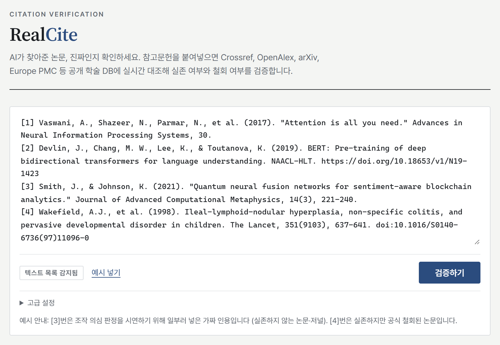
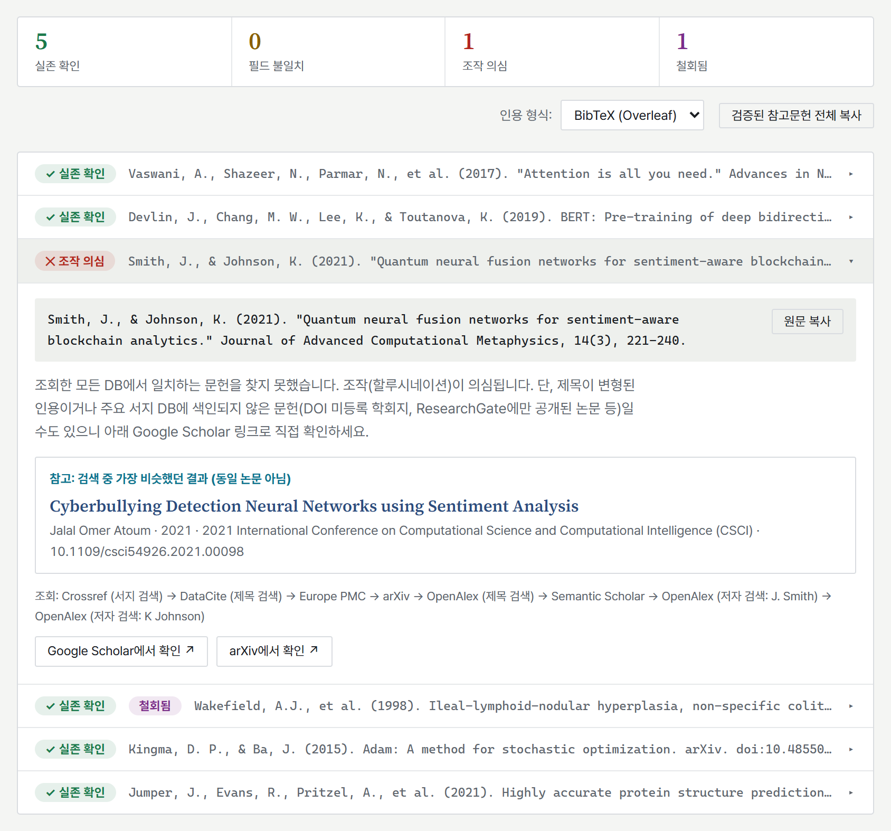

# RealCite

AI가 찾아준 논문 인용이 실제로 존재하는지 확인하는 웹 앱입니다. 참고문헌 목록을 붙여넣으면 Crossref, DataCite, Europe PMC, arXiv, OpenAlex, Semantic Scholar에 대조해 실존 여부, 메타데이터 정확성, 철회 여부를 확인합니다.

운영 중: https://realcite.pages.dev · TypeScript · React · Vite · Cloudflare Pages

<table>
<tr>
<td width="50%" valign="top">
<picture>
  <source media="(prefers-color-scheme: dark)" srcset="docs/main-dark.png">
  
</picture>
</td>
<td width="50%" valign="top">
<picture>
  <source media="(prefers-color-scheme: dark)" srcset="docs/results-dark.png">
  
</picture>
</td>
</tr>
</table>

왼쪽은 예시 목록을 넣은 메인 화면, 오른쪽은 그 6건을 검증한 결과입니다. 세 번째 항목(Smith & Johnson, 2021)은 조작 의심 판정을 보여주려고 일부러 넣은 가짜 인용이고, Wakefield (1998)는 실존하지만 철회된 논문입니다. 카드를 펼치면 판정 사유, 가장 비슷했던 논문, 조회한 소스의 순서가 보입니다.

## 만들게 된 배경

연구실에서 AI에게 논문을 찾아 달라고 하면 그럴듯한 제목과 저자가 나오지만, 그중 일부는 존재하지 않거나 여러 논문이 뒤섞인 것이었습니다. 10개 상용 LLM을 감사한 연구에서도 생성된 인용의 11.4%에서 56.8%가 조작으로 나타났습니다 ([Naser, 2026](https://arxiv.org/abs/2603.03299)).

틀린 인용이 하나 나오면 목록 전체를 다시 의심해야 해서, AI를 쓴 것이 오히려 시간을 더 잡아먹는 경우도 있었습니다. 같은 연구실 학우들도 같은 과정을 각자 반복하고 있었습니다.

그래서 참고문헌 목록을 통째로 붙여넣으면 공개 학술 DB에 대조해 주는 도구를 만들었습니다. 설치 없이 링크 하나로 쓸 수 있도록 웹으로 만들었고, 검증이 끝나면 교정된 참고문헌을 바로 복사해 원고에 넣을 수 있게 했습니다.

## 설계 원칙

1. **검증기도 틀릴 수 있습니다.**
   한 소스에서 못 찾았다고 조작으로 단정하지 않고, 여섯 소스를 순서대로 다시 찾습니다. 소스가 장애 상태라서 못 찾은 것은 "확인 불가"로 따로 표시합니다. 조작 의심과 확인 불가를 섞으면 사용자가 결국 전부 다시 확인해야 합니다.

2. **DOI가 열린다고 진짜는 아닙니다.**
   가짜 인용이 실제 논문의 DOI를 가져다 붙이는 경우가 있어서, DOI가 해석돼도 제목, 저자, 연도를 교차 대조합니다.

3. **판정에는 근거를 붙입니다.**
   실존 확인, 필드 불일치, 유사 논문 발견, 조작 의심, 확인 불가의 다섯 단계로 나누고, 매칭된 DOI, 필드 비교표, 조회한 소스를 함께 보여줍니다. 맞다 틀리다 둘로만 답하지 않습니다.

4. **철회된 논문을 잡습니다.**
   실존하더라도 철회된 논문이면 인용하면 안 되므로, Retraction Watch 데이터(Crossref 통합)와 OpenAlex 플래그로 철회 여부를 표시합니다.

5. **결과를 바로 쓸 수 있고, 어디에도 저장되지 않습니다.**
   교정된 참고문헌을 BibTeX, APA 7, MLA 9, Chicago, IEEE, Vancouver 형식으로 복사할 수 있습니다. 서버 없이 브라우저가 무료 학술 API를 직접 호출하고 정적 호스팅만 쓰므로, 미발표 원고의 참고문헌이 외부 서버에 남지 않고 운영비도 0원입니다. CORS 헤더가 없는 Semantic Scholar와 arXiv만 Cloudflare Worker(`proxy/`)가 응답을 그대로 중계하며, 이 Worker도 요청을 저장하지 않습니다.

## 사용법

1. 참고문헌 목록을 붙여넣습니다. 플레인텍스트([1] 번호 목록 또는 줄 단위), BibTeX, RIS 형식을 자동으로 감지합니다.
2. 검증 결과를 확인합니다. 항목마다 판정과 근거가 붙고, 필드 불일치는 올바른 값을 같이 보여줍니다.
3. 필요한 형식으로 복사합니다. 전체 복사 또는 논문별 복사.

## 검증 파이프라인

```
입력 → 파싱 (BibTeX/RIS/플레인텍스트, DOI·제목·연도 추출)
  → [DOI 있음] Crossref 해석 → DataCite(arXiv 등 저장소 DOI) → OpenAlex
      → 제목 일치 확인 (DOI 도용 탐지)
  → [DOI 없음/실패] Crossref 서지 검색 (query.bibliographic)
      → 확신 미달 시 DataCite → Europe PMC → arXiv → OpenAlex 제목 검색 → Semantic Scholar
      → 그래도 없으면 OpenAlex 저자+연도(±2) 검색으로 유사 논문 제시
      → 후보 스코어링: 제목 유사도 + 연도·저자 일치 보너스/페널티
  → 철회 확인 (Crossref filter=updates: + OpenAlex is_retracted)
  → 판정 + 근거 + 교정 참고문헌
```

## 개발

Node 22 이상이 필요합니다.

```bash
npm install
npm run dev                 # 개발 서버 (localhost:5173)
npm test                    # 단위 테스트 (네트워크 없음)
npm run build               # 정적 빌드 → dist/
npx tsx scripts/smoke.ts    # 실제 API에 대한 스모크 테스트
node scripts/browse.mjs .   # 헤드리스 브라우저 E2E (Edge 필요)
node scripts/readme-shot.mjs docs   # README 스크린샷 갱신 (밝은·어두운 테마 4장)
npm run deploy              # 빌드 후 Cloudflare Pages 배포
```

파싱, 조회, 판정, 서식 모듈은 `src/lib/`에 UI와 분리된 순수 모듈로 두었습니다. 나중에 MCP 서버나 CLI로 붙이면 AI가 논문을 찾는 시점에 바로 검증할 수 있습니다.

테스트는 두 층입니다. 단위 테스트는 학술 API를 모킹해 파싱, 유사도, 서식과 판정 규칙을 고정하고, 스모크 테스트는 실제 API를 호출하며 쓰면서 발견한 오판정 사례를 케이스로 쌓습니다.

## 사용 시 유의할 점

- OpenAlex는 IP당 무료 일일 크레딧제라서, 같은 IP를 공유하는 환경(대학 캠퍼스 등)에서 한도가 소진될 수 있습니다. 이 경우 나머지 소스만으로 진행하며 "못 찾음"은 확인 불가로 표시됩니다.
- Semantic Scholar는 키 없는 공유 풀이라 간헐적으로 429를 반환합니다. 안정화는 Cloudflare Workers 프록시로 처리합니다.
- 상류 DB의 메타데이터 오류는 그대로 반영됩니다. 이런 경우 필드 불일치로 표시되어 수동 확인을 유도합니다.
- 한국어 문헌(KCI)은 아직 지원하지 않습니다. 프록시와 라이선스 확인이 필요합니다.
- 자동 판정은 참고용입니다. 필드 불일치와 조작 의심 항목은 반드시 원문을 확인해야 합니다.
